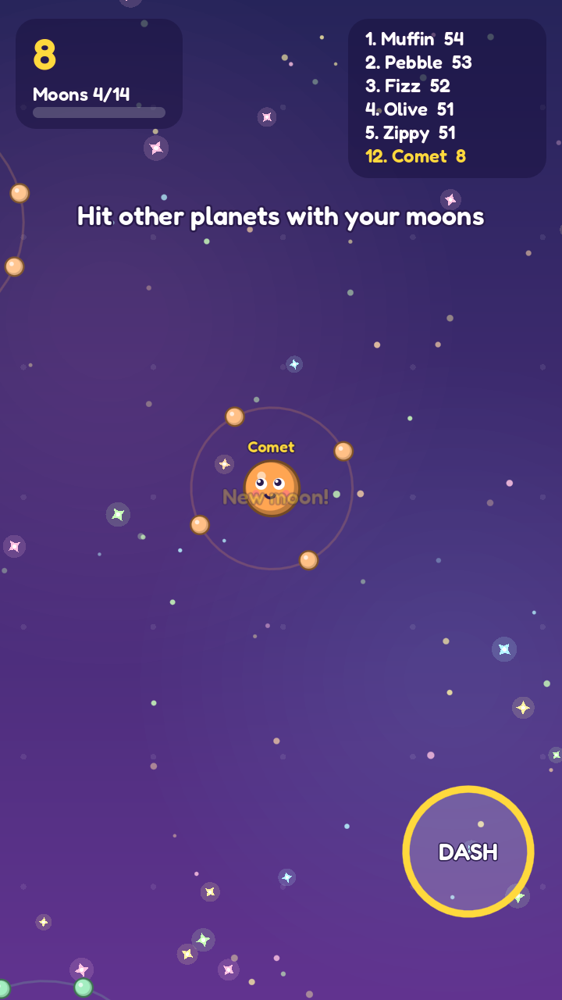
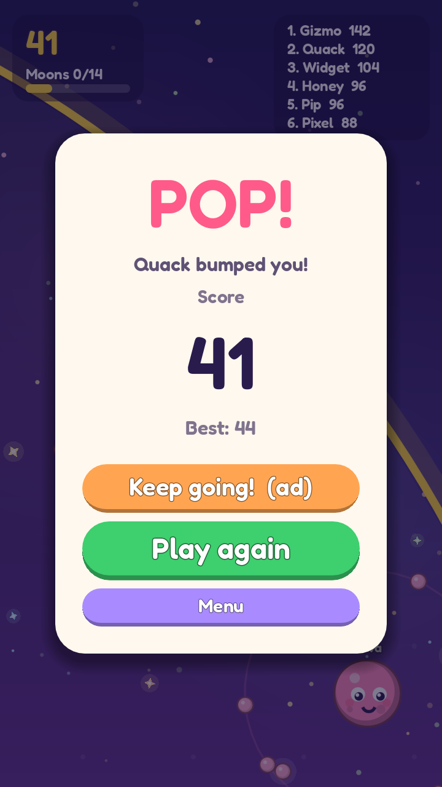

# Orbit (working title)

A small, kid-friendly ".io style" arena game for phones, made with Godot 4.

You are a little planet. Collect stardust to grow moons that circle around you.
There is one rule for fighting: **touch another planet with one of your moons and
it loses a moon. A planet with no moons left pops on the next hit.** So moons are
both your lives and your weapons. Small planets are faster, big planets are stronger.

**Dash** (button bottom right, or Space) zooms you forward for a moment. Nothing
can hit you while you dash, so you can slip past a big planet's moons to reach it.
Whoever leads the scoreboard wears a crown.

| Menu | Playing | Game over |
|---|---|---|
|  |  |  |

This is version 1: one arena, 11 computer players, leaderboard, skins, sounds,
best-score saving. No real ads and no online play yet (see below).

## Run it

1. Download **Godot 4.5 or newer** (free, standard version) from https://godotengine.org/download
2. Open Godot, press **Import**, and pick the `project.godot` file in this folder.
3. Press **F5** (or the Play button, top right).

Controls: hold the mouse button (or a finger) and drag to steer; tap DASH to dash.
On a keyboard, arrow keys steer and Space dashes.

## Change how it plays

Open `scripts/config.gd`. Every speed, size, colour, name and score value is
there with a comment. Good ones to try first:

- `BOT_BRAVERY` - how much the computer players hunt (0 = peaceful, 1 = fierce)
- `DASH_SPEED`, `DASH_TIME`, `DASH_COOLDOWN` - how the dash feels
- `BOT_COUNT`, `DUST_COUNT`, `ARENA_RADIUS` - how busy the arena is
- `SKINS` - the planet colours shown on the menu
- `NAMES` - names used by bots and the "New name" button

## Files

| File | What it does |
|---|---|
| `scripts/config.gd` | All tweakable numbers, colours and names |
| `scripts/main.gd` | Starts everything, joystick, menu / playing / game over |
| `scripts/world.gd` | Game rules (pickups, bumps, pops) and drawing |
| `scripts/planet.gd` | One planet: movement and its ring of moons |
| `scripts/bot_brain.gd` | Computer player steering |
| `scripts/art.gd` | Drawing of planets, moons, sparkles (no image files needed) |
| `scripts/ui.gd` | Menu, score display, leaderboard, game-over card |
| `scripts/ad_manager.gd` | Ad placeholder (see below) |
| `scripts/sfx.gd` | Sound effects |
| `dev/shots.gd` | Developer tool that plays a demo and saves screenshots |

## Put it on an Android phone

Follow Godot's official guide, "Exporting for Android":
https://docs.godotengine.org/en/stable/tutorials/export/exporting_for_android.html

Short version: install Android Studio (for the Android SDK) and a JDK, point
Godot at them in *Editor Settings > Export > Android*, add an Android preset in
*Project > Export*, plug in your phone with USB debugging on, and press the
small Android button next to Play.

## Adding real ads

The game only calls two functions in `scripts/ad_manager.gd`:
`show_rewarded()` (the "Keep going!" button) and `game_over()` (a full-screen
ad every 3rd game over). Right now they only print a message. To earn money,
install a Godot AdMob plugin and call it from those two functions.

**Important, because this game is kid-friendly:** if the Play Store listing
targets children (under 13), Google's *Families Policy* applies. You must use
an ad SDK from Google's "Families Self-Certified Ads SDK" list, show only
child-appropriate, non-personalised ads, and fill in the target-age and data
safety forms honestly. Read the policy before adding ads.

## Multiplayer roadmap

The player and the bots already share one rule set; the only difference is who
fills in each planet's `input_dir`. That is deliberate:

1. **Now:** bots only, works offline.
2. **Next:** same Wi-Fi / hotspot play, one phone hosts (Godot's built-in ENet
   multiplayer). Players send `input_dir`, the host runs `world.gd` and sends
   back positions. No server cost.
3. **Later:** online play through a relay service, if the game finds players.

## Credits

- Font: Fredoka, SIL Open Font License (`assets/fonts/OFL.txt`)
- Sounds: generated for this project
