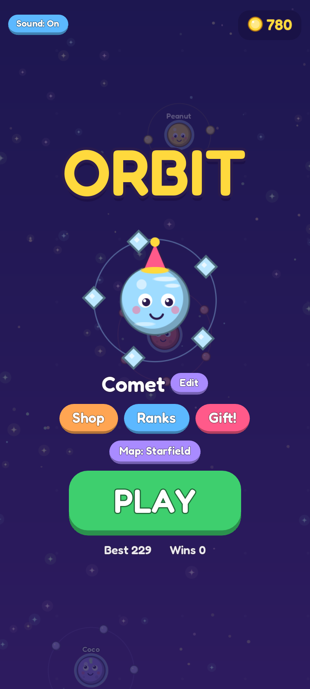
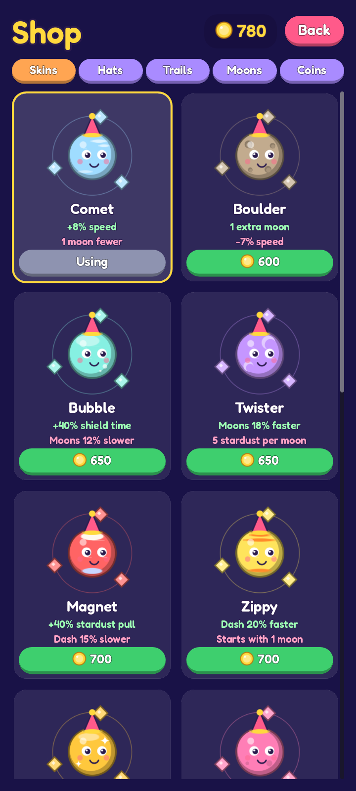
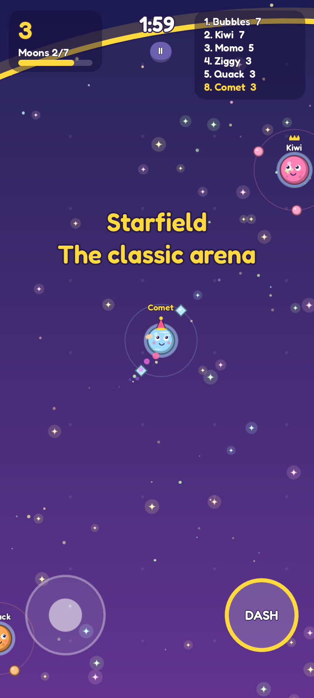
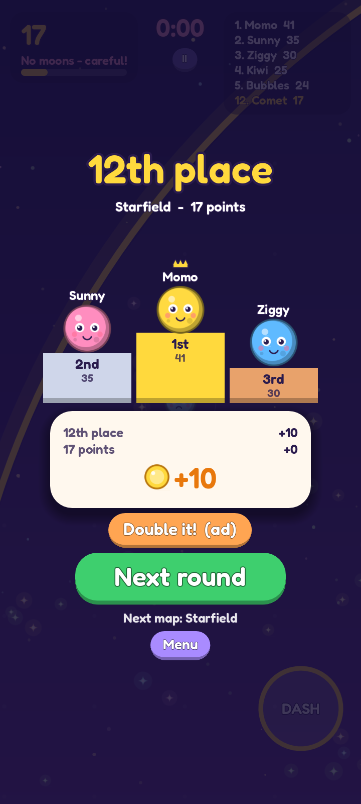

# Orbit (working title)

A small, kid-friendly ".io style" arena game for phones, made with Godot 4.

You are a little planet. Collect stardust to grow moons that circle around you.
There is one rule for fighting: **touch another planet with one of your moons and
it loses half its moons. A planet with no moons left pops on the next hit.** So
moons are both your lives and your weapons.

**Dash** (button bottom right, or Space) zooms you forward for a moment. Nothing
can hit you while you dash, so you can slip past a big planet's moons.

| Menu | Shop | Round | Results |
|---|---|---|---|
|  |  |  |  |

## What is in the game

- **Rounds:** 2 minutes, you against 11 computer players. Popped planets come
  back after 3 seconds. Highest score when the time is up wins.
- **Maps:** Starfield (classic), Asteroid Belt (rocks block the way), Black Hole
  (the middle pulls you in) and Ice Ring (small and slippery). They rotate, or
  you pick one on the menu.
- **Coins:** earned every round (place, score, pops), from a daily gift with a
  7-day streak, and from "watch an ad" buttons.
- **Shop:** planet skins, hats, trails and moon styles, paid with coins.
- **Skins with stats:** each special skin is a bit better at one thing and a bit
  worse at another, so none of them is simply the best.
- **Custom names** with a basic bad-word filter.
- **Ranks screen** with Country and Global tabs (offline for now, see below).

Three things are **placeholders** in this version and say so in the game or the code:
ads (`scripts/ad_manager.gd`), real-money purchases (`scripts/store.gd`) and the
online leaderboard (`scripts/leaderboard.gd`).

## Run it

1. Download **Godot 4.5 or newer** (free, standard version) from https://godotengine.org/download
2. Open Godot, press **Import**, and pick the `project.godot` file in this folder.
3. Press **F5** (or the Play button, top right).

Controls: push the stick (bottom left) with a finger or the mouse to steer; tap DASH to dash.
On a keyboard, arrow keys steer, Space dashes and Escape pauses.

## Change how it plays

Three files hold everything you are likely to tweak, each with comments:

| File | What you change there |
|---|---|
| `scripts/config.gd` | Round length, speeds, fighting, dash, score, coin rewards, bot names |
| `scripts/maps.gd` | The maps: size, colours, asteroids, black hole, slipperiness |
| `scripts/catalog.gd` | Skins and their stats, hats, trails, moon styles, prices, coin packs |

Good ones to try first: `ROUND_TIME`, `BOT_BRAVERY` (how much bots hunt),
`HIT_LOSS` (how quickly fights end), `PLACE_COINS`, and the prices in `catalog.gd`.
To add a skin, copy an entry in `SKINS` and give it a new id, name and colour.

## Files

| File | What it does |
|---|---|
| `scripts/main.gd` | Starts everything, touch controls, runs the rounds |
| `scripts/world.gd` | Game rules (pickups, bumps, pops, map hazards) and drawing |
| `scripts/planet.gd` | One planet: movement, its ring of moons, its skin stats |
| `scripts/bot_brain.gd` | Computer player steering |
| `scripts/art.gd` | All drawing (planets, hats, moons...) from a few shared shapes |
| `scripts/background.gd` | Sky colours and stars |
| `scripts/profile.gd` | The saved player data: name, coins, items, records |
| `scripts/ui.gd` | Menu and in-game display; owns the screens below |
| `scripts/shop_ui.gd`, `results_ui.gd`, `ranks_ui.gd`, `popups.gd` | Shop, round results, ranks, pop-up cards |
| `scripts/widgets.gd` | Shared buttons, labels and cards |
| `scripts/name_filter.gd` | Checks typed names |
| `scripts/ad_manager.gd`, `store.gd`, `leaderboard.gd` | The three placeholders (ads, purchases, online ranks) |
| `scripts/sfx.gd` | Sound effects |
| `dev/` | Developer tools: screenshot tour, browser test page |

## Put it on an Android phone

Follow Godot's official guide, "Exporting for Android":
https://docs.godotengine.org/en/stable/tutorials/export/exporting_for_android.html

Short version: install Android Studio (for the Android SDK) and a JDK, point
Godot at them in *Editor Settings > Export > Android*, add an Android preset in
*Project > Export*, plug in your phone with USB debugging on, and press the
small Android button next to Play.

## Browser build

*Project > Export > Web* gives a folder you can upload to any web host or to
game portals. `dev/build_test_page.py` repacks that export for the Claude test
link (see the comment at the top of that file).

## Before a real release

**Ads.** The game calls `Ads.show_rewarded()` (double coins, free coins) and
`Ads.round_finished()` (a full-screen ad every 3rd round, unless "No Ads" was
bought). Both only print a message and hand out the reward straight away.
Install a Godot AdMob plugin and call it from those two functions.

**Real purchases.** `Store.buy()` hands the pack out for free and the shop says
so. Connect Google Play Billing there and grant the pack only after Google
confirms the payment. Take the prices shown from Google Play instead of the
placeholder texts in `catalog.gd`.

**Online leaderboard.** `leaderboard.gd` has three small functions that return
the player's own rounds from the device. Point them at a server (a leaderboard
service or your own) and the Ranks screen shows real Country and Global lists.
The server must also check names and scores; never trust what the app sends.

**Children.** If the Play Store listing targets children under 13, Google's
*Families Policy* applies: only ad SDKs from Google's Families Self-Certified
list, no personalised ads, stricter rules for purchases, and typed names shown
to other players need proper moderation. Read the policy before adding any of
the three things above.

## Multiplayer roadmap

The player and the bots share one rule set; the only difference is who fills in
each planet's `input_dir`. That is deliberate:

1. **Now:** bots only, works offline.
2. **Next:** same Wi-Fi / hotspot play, one phone hosts (Godot's built-in ENet
   multiplayer). Players send `input_dir`, the host runs `world.gd` and sends
   back positions. No server cost.
3. **Later:** online play through a relay service, if the game finds players.

## Credits

- Font: Fredoka, SIL Open Font License (`assets/fonts/OFL.txt`)
- Sounds: generated for this project
